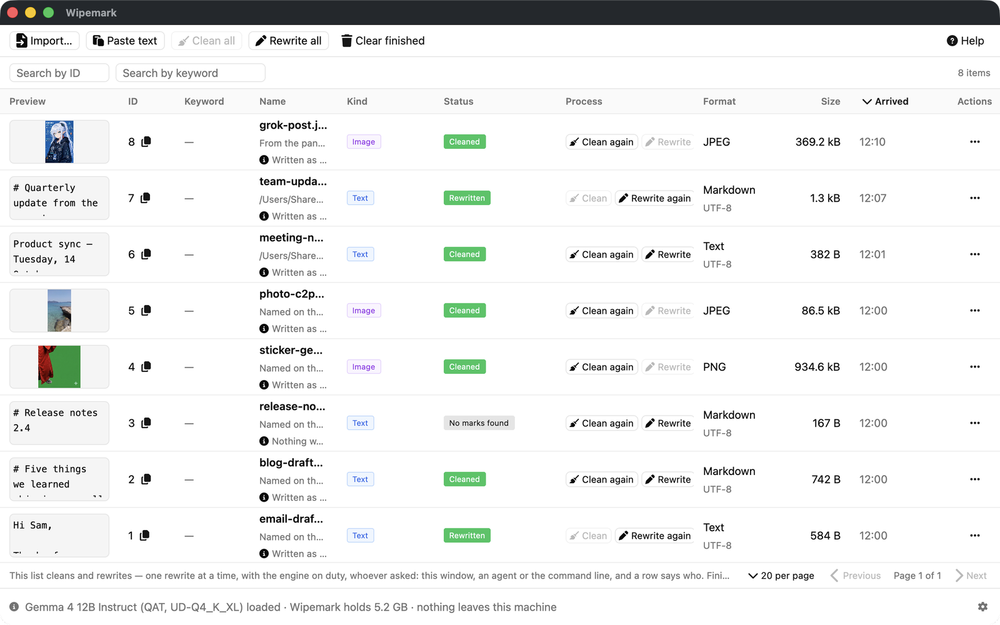
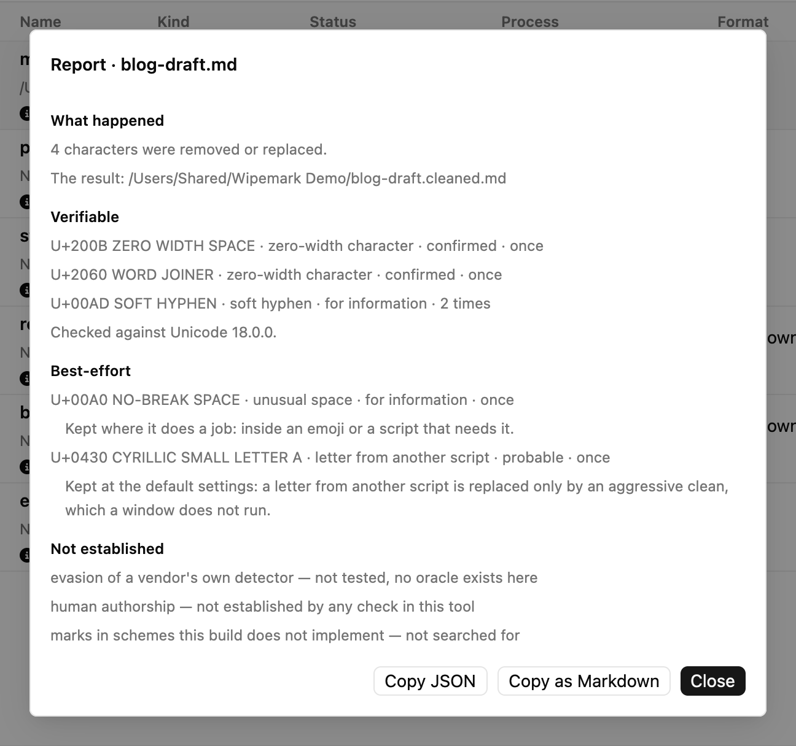
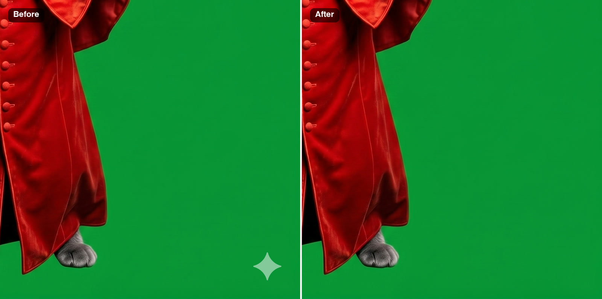
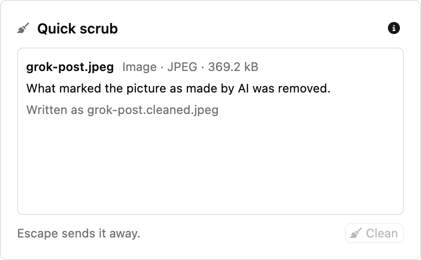
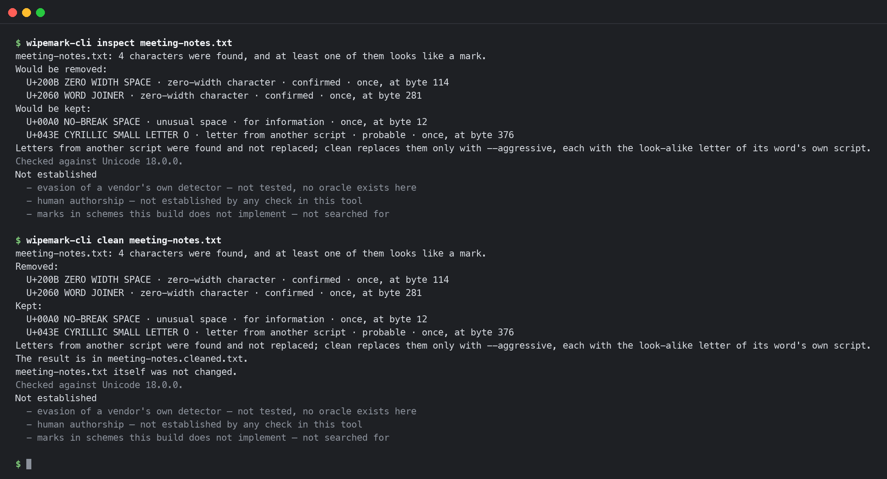
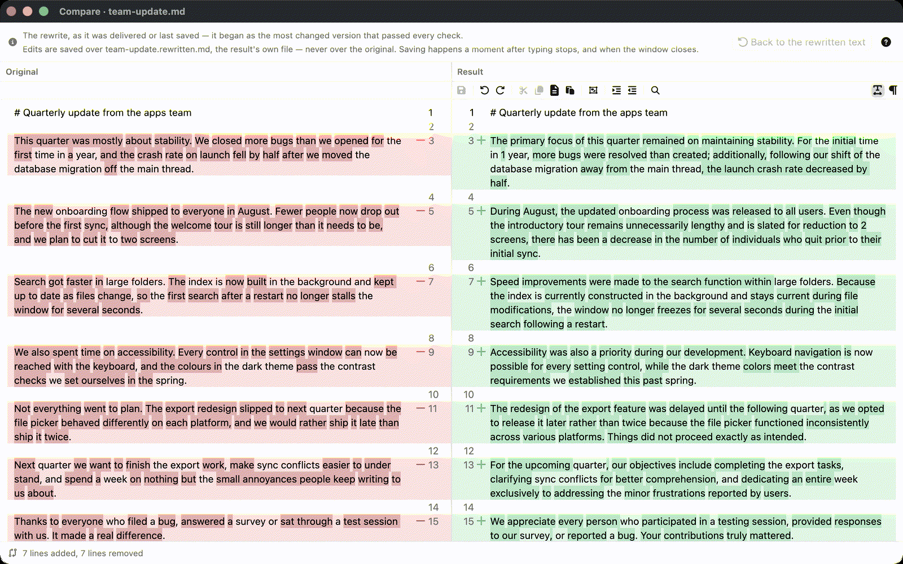
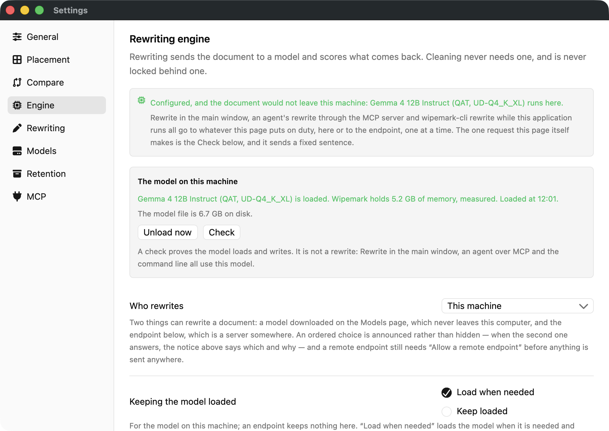

<p align="center">
  
  <br>
  <strong>Wipemark</strong>
</p>

[](https://github.com/GigLaboCom/wipemark-app/actions/workflows/gate.yml) [](LICENSE.md) [](#install)

Take AI provenance marks out of your own text and pictures, on your own machine.

Wipemark is a native desktop application for **macOS on Apple Silicon** and
**Linux x86_64**, written in Rust on [GPUI](https://github.com/zed-industries/zed),
with a command line and an MCP server for AI agents. It removes what
software put into your content without asking: invisible Unicode
characters in a text, AI provenance metadata in a picture, and the visible
marks of Gemini and Grok. If you want it, it also rewrites a text with a
language model, on this machine or on a server you choose. Your file is
never touched. The result is written beside it, with a report of what was
done and of what cannot be established.

```text
Wipemark        The windows: the main list, the panel, Compare, Report, Settings, the tray
wipemark-cli    The same libraries on the command line, with exit codes for hooks and CI
MCP server      The same work for AI agents, on 127.0.0.1, off until you turn it on
```

<picture>
  <source media="(prefers-color-scheme: dark)" srcset="docs/screenshots/main-window-dark.png">
  
</picture>

**Version 0.1.2** · [Download](https://github.com/GigLaboCom/wipemark-app/releases/latest) · [Release notes](docs/release/0.1.2.md) · [Contributing](CONTRIBUTING.md) · [Licence](#licence)

[Features](#features) · [Use cases](#use-cases) · [How it works](#how-it-works) · [Install](#install) · [Quick start](#quick-start) · [Limitations](#limitations-of-012) · [Development](#development)

## Features

- **Invisible characters out**: zero-width characters, bidirectional
  controls, tag characters, stray variation selectors, private-use and
  noncharacter code points. Each one is counted and its position given.
  No model, always offline.
- **What belongs is kept**: a joiner inside an emoji or between two
  letters of a joining script, the bidi marks of a right-to-left
  paragraph, a flag's tag characters, a selector after a base it is
  defined for.
- **Look-alike letters reported**: a Cyrillic "а" inside an English word is
  found and reported, and replaced only when you ask.
- **Picture metadata**: C2PA manifests, generator parameters, and the XMP,
  IPTC or EXIF blocks that name an AI source, out of PNG, JPEG and WebP.
  The image data is not re-encoded, and colour is never removed.
- **Visible marks, proved first**: Gemini's sparkle and Grok's mark on
  pictures from X come off only after their shape and strength are proved
  at that place. What cannot be proved stays and is reported.
- **Rewriting, local or remote**: paragraph by paragraph, with llama.cpp on
  this machine (Metal on a Mac, Vulkan on Linux) or Ollama or any
  OpenAI-compatible endpoint. Headings, code, tables and links never reach
  the model.
- **A failed answer is never used**: identifiers, numbers, protected spans,
  script, length and language are checked on every answer. A paragraph that
  fails keeps its cleaned original, and a rewrite that rewrote nothing
  writes nothing.
- **One queue that survives `kill -9`**: rewrites run one at a time,
  whoever asked, and go on from the paragraph they had reached.
- **A report with three shelves**: what can be verified, what was
  best-effort, and what is not established. The third shelf is never empty.
- **Your file stays as it is**: the result goes beside it as
  `name.cleaned.ext` or `name.rewritten.ext`, and nothing is written over.
- **Local by default, no telemetry**: cleaning never leaves the machine, and
  a key lives in the system's credential store.
- **English, German and Russian**, with light, dark or system appearance.

## Use cases

### A text from an assistant, before you send it

Text copied out of a chat can carry characters you cannot see. They break a
search, a diff or an identifier, and they travel with the text wherever you
paste it.

1. Drop the file on the main window, or press *Paste text*.
2. Press *Clean*. The result is written beside the file as
   `name.cleaned.ext`; a pasted text's result stays in its row.
3. Open *Report…* from the row's menu to see every character that was
   removed, where it was, and what was kept and why.



### A picture from a generator

A generated picture can carry your whole prompt and workflow in its
metadata, a C2PA manifest, or a mark in a corner. Drop it and press
*Clean*: the provenance metadata goes, camera EXIF that names no generator
stays, and a Gemini or Grok mark comes off once it is proved. Before a byte
is written, the result is checked: it must decode to the restored picture,
nothing outside the mark may have moved, and the mark must no longer be
found.



### In passing, from the panel

Summon the panel over whatever you are working in (**⌘⌥D** on a Mac,
**Ctrl+Alt+D** elsewhere, or the tray menu), drop or paste onto it, and
press *Clean*. Everything it takes is a row of the same list in the main
window.



### Invisible characters kept out of a repository

The "Trojan Source" kind of bidirectional control, or a zero-width space in
an identifier, can be stopped in a pre-commit hook or a CI step:

```sh
wipemark-cli audit src/                        # exit 1 when anything looks like a mark
wipemark-cli audit . --sarif > wipemark.sarif  # SARIF 2.1.0, for code scanning
```

`audit` walks a folder, skips hidden entries such as `.git`, and inspects
every text file and picture. It exits `0` when nothing looks like a mark,
`1` on findings and `3` when any file could not be read, so a scan with a
hole in it never passes as clean.



### A rewrite, on this machine

Pick a model on the Models page (the first launch recommends one that fits
this machine's memory), then press *Rewrite* on a text row. The model runs
here, and the Engine page says so. Read the result in Compare before you use
it: the changed lines and words are marked, and an edit is saved over the
result's own file, never over the original.





### An agent that cleans its own output

Turn on **Serve over MCP** under Settings › MCP, then paste the snippet from
that page into your client. For Claude Code:

```json
{
  "mcpServers": {
    "wipemark": { "type": "http", "url": "http://127.0.0.1:5056/mcp" }
  }
}
```

The agent gets `inspect`, `clean`, `inspect_image`, `clean_image` and
`rewrite`. Every call it makes appears as a row in the main window's list,
unless it passes `"record": false`.

### What it is not for

Passing off someone else's work as yours, removing marks you are required
to keep, or getting past a detector. Wipemark cannot test whether any
detector will flag a text or a picture, so it does not claim that one
won't, and every report says so.

## What it does

### The report and its three shelves

| shelf | what it holds |
|---|---|
| **verifiable** | what was removed or replaced, counted, with positions, so anyone can check it |
| **best-effort** | what a model did when it rewrote the text, and the scores that can be computed |
| **not established** | claims Wipemark refuses to make: that a vendor's own detector is evaded (not tested, there is no oracle), that the text is of human authorship, that no mark remains in a scheme this version does not implement |

A picture's third shelf starts with the marks no eye can see in the pixels.
Wipemark does not look for those, and it does not remove them.

### Text

- **Removes** zero-width characters (U+200B, U+200C, U+2060, a U+FEFF that
  is not a byte order mark), bidirectional controls, tag characters,
  variation selectors that follow no base they belong to, the soft hyphen,
  private-use and noncharacter code points, and other default-ignorable
  characters.
- **Keeps what belongs:** a zero-width joiner inside an emoji sequence; a
  joiner or non-joiner between two letters of a joining script;
  bidirectional marks, isolates and embeddings in a paragraph with
  right-to-left letters (the two overrides used for "Trojan Source" are
  always removed); the tag characters of a flag; a variation selector after
  a base it is defined for.
- **Reports and keeps** look-alike letters from another script inside a
  word, and spaces other than U+0020. The letters are replaced only on
  request (`--aggressive` on the command line, `aggressive` over MCP), and
  NFKC normalisation is optional too (`--nfkc`).
- Uses the **Unicode 18.0.0** tables, and every report names that version.
  A text goes back in the encoding it came in.

### Pictures

- **Formats:** PNG, JPEG and WebP. TIFF, HEIC and AVIF are recognised and
  refused by name.
- **Metadata, by default only AI provenance:** a C2PA manifest or an XMP
  reference to one; an IPTC Digital Source Type that says a model or an
  algorithm made the picture or contributed to it; a generator's parameters
  or signature (Stable Diffusion web UI and its forks, ComfyUI, InvokeAI,
  NovelAI, Midjourney, OpenAI, Adobe Firefly, Google, Microsoft). Camera
  EXIF that names no generator, the orientation, the colour profile and the
  physical size stay. Asked for all metadata (`--all-metadata`, or `scope`
  over MCP), it removes every block but colour.
- **Visible marks:**

  | mark | where it appears |
  |---|---|
  | Gemini sparkle, V1 and V2 | Google Gemini pictures. Gemini's newer outputs carry no visible mark (observed in October 2026); the profiles stay so that pictures made before are still cleaned. |
  | Grok wordmark, dark and light | Grok pictures as X hands them out |

  A picture whose mark came off is written again: PNG losslessly, JPEG at
  quality 95, WebP as lossless.

### Rewriting

- Plain text, Markdown and HTML are understood. Headings, code, front
  matter, tables and links are protected, and everything outside the
  rewritten paragraphs comes back byte for byte. The text is cleaned before
  the model and after it.
- *Rewrite all* states the price (calls, tokens, time, or "unknown") before
  it starts. *Pause*, *Resume* and *Cancel* work while it runs.
- **Who rewrites** is chosen on the Engine page: this machine only, an
  endpoint only, or one before the other. When the second one answers, the
  page says which and why.
- The templates are written for English, German and Russian and can be
  edited on the Rewriting page. *Shipped* is the default profile, *Keep
  voice* can be chosen, and you can save your own.

### The windows

| | |
|---|---|
| **Main window** | One list of everything that arrived: what you drop, paste or import, and what the panel, the command line and agents processed. *Clean*, *Rewrite*, *Clean all* and *Rewrite all* act on rows. A row's menu has *Report…*, *Compare with the result*, *Open with*, *Open the result*, *Show the result in its folder*, *Copy the result*, and *Clean again* or *Rewrite again* once a row is done. An action that cannot run is greyed and says why. The status bar names the engine on duty and, while a model is loaded here, offers *Unload*. |
| **Panel** | A small window you summon over whatever you are working in. Drop, paste or import onto it, then press *Clean*. It comes and goes on its own. |
| **Compare** | A result beside its original, with the changed lines and words marked. Edit the result and save it over the result's own file, never over the original; it can also save as you type. *Copy all* copies the result. |
| **Report** | The three shelves for one row, with *Copy as Markdown* and *Copy JSON*. |
| **Settings** | **General** (appearance, language, the two shortcuts, what happens when something arrives, new versions), **Placement**, **Compare**, **Engine** (who rewrites; the endpoint and its key), **Rewriting** (templates and profiles), **Models**, **Retention** (where results go, what is kept and for how long), **MCP**. Every change is saved as you make it. |
| **First launch** | A short walk-through: what this machine has room for, who rewrites, and which model or endpoint. Skip it, and run it again from General. |
| **Menu bar / tray** | *Show Wipemark*, *Show the panel* or *Hide the panel*, *Unload model* (while one is loaded), *Appearance*, *Settings…*, *Quit Wipemark*. While the tray can bring the window back, closing the main window only hides it. |

### The command line

| command | what it does |
|---|---|
| `inspect <file>` | reports what would be removed, replaced or kept, for a text or a picture (`--json`) |
| `clean <file>` | writes `name.cleaned.ext` beside the file; `-o <path>` writes elsewhere, `-o -` to standard output, `--in-place` replaces the file after setting the original aside |
| `audit <folder>` | inspects every text file and picture under a folder, hidden entries skipped (`--json`, or `--sarif` for SARIF 2.1.0) |
| `rewrite <file>` | writes `name.rewritten.ext`; with the application running, the application does the rewrite and the CLI says so |
| `models list \| pull \| verify \| rm \| add \| forget` | the model catalogue and the models you added, without the window |
| `update --check` | says whether a newer, verified version exists; installing is the application's job |

| exit | meaning |
|---|---|
| `0` | clean: nothing that looks like a mark (for `clean` and `rewrite`, the result was written) |
| `1` | findings: something that looks like a mark was there (and was removed, if you cleaned) |
| `2` | usage or refusal, and nothing was written: a result already beside the file, no engine that may answer, a rewrite that rewrote nothing |
| `3` | partial: something could not be read or examined, a mark stayed, or only some paragraphs were rewritten. Inconclusive is not clean, so `3` beats `1`. |

The command line refuses to write over an existing result; `-o` names the
target explicitly. Every command's codes are in
[docs/architecture/cli.md](docs/architecture/cli.md).

### The MCP server

Streamable HTTP, `POST /mcp`, **off until you turn it on**. It then listens
on `127.0.0.1:5056` and starts with the application.

| tool | what it does |
|---|---|
| `inspect`, `clean` | the text layer on a text: the report, or `{text, report}` |
| `inspect_image`, `clean_image` | the same for a PNG, JPEG or WebP sent as base64: its metadata, and the visible marks this version knows |
| `rewrite` | a rewrite by the engine on duty, in the same queue as the windows |

A request carrying an `Origin` header from anywhere but this machine is
refused, so a web page cannot drive the server. A call that cannot run
comes back as an error that says why, never as an empty report. A request
over 1 MiB is refused whole. If port 5056 is taken, the server moves up to
ten ports along, and the MCP page says where it landed.

## How it works

- **Two layers, kept apart.** *Layer A* is deterministic: Unicode tables,
  a classifier and a scrubber, the same answer every time. *Layer B* is the
  rewrite: best-effort, judged by checks, and always followed by Layer A
  again. A picture goes through a metadata pass and a visible-mark pass,
  and is written once.
- **Local by default.** Cleaning never leaves the machine. A rewrite goes
  to the model on this machine, or to the endpoint you configured. An
  endpoint on another machine is refused until you turn on *Allow a remote
  endpoint* on the Engine page.
- **Keys stay safe.** An API key is kept in the system's credential store
  (the macOS Keychain, the Secret Service on Linux), never in a file, and
  never sent over plain `http` to another machine.
- **No telemetry.** The only connections beyond this machine are the model
  downloads you start, the endpoint you configure, and, if you turn it on,
  a check once a day for a new version that sends nothing about you or your
  documents.
- **Nothing written over.** A result goes beside the file, or into a
  folder named on the Retention page. Replacing the file is an option you
  choose (*In place*, `--in-place`), and then the original is first set
  aside as `name.original.ext`. In the windows, if `name.cleaned.ext` is
  taken, the row writes `name.cleaned-<row id>.ext`.
- **Nothing kept unless asked.** The list holds metadata: the name, the
  path, what was asked, what was found, where the result went; never a
  file's text. A pasted text stays in the database while its row is in the
  list, and finished rows leave the list after a week by default. The logs
  never contain a document's text.
- **One Wipemark per data folder.** A second launch hands its request to
  the running one, which is how the panel's shortcut works on GNOME.

## Install

Download from **[GitHub Releases](https://github.com/GigLaboCom/wipemark-app/releases/latest)**.

| platform | file |
|---|---|
| macOS on Apple Silicon (M1 or later), macOS 12 or later | `Wipemark-0.1.2-arm64.dmg` |
| Linux x86_64, glibc 2.39 or later (Ubuntu 24.04, Debian 13, Fedora 40 and newer) | `Wipemark-0.1.2-x86_64.AppImage`, or `wipemark_0.1.2_amd64.deb` for Ubuntu and Debian |
| Windows | not in this version |

The [release notes](docs/release/0.1.2.md) cover each platform in full,
uninstalling included.

**macOS.** Open the `.dmg` and drag **Wipemark** onto **Applications**.
The app is signed with a Developer ID and notarized by Apple. The command
line is inside it:

```sh
ln -s /Applications/Wipemark.app/Contents/MacOS/wipemark-cli ~/.local/bin/wipemark-cli
```

**Linux.** The AppImage carries what it needs except GTK 3 and the
graphics driver. The `.deb` installs its dependencies through apt and puts
`wipemark` and `wipemark-cli` in `/usr/bin/`.

```sh
chmod +x Wipemark-0.1.2-x86_64.AppImage
./Wipemark-0.1.2-x86_64.AppImage                        # the application
./Wipemark-0.1.2-x86_64.AppImage --cli inspect notes.md # the command line

sudo apt install ./wipemark_0.1.2_amd64.deb
```

The local model needs a Vulkan driver. The tray icon needs
`libayatana-appindicator3`, and on GNOME the AppIndicator extension;
without a tray, closing the main window quits. Under Wayland the windows
run through XWayland so the panel opens where you put it;
`WIPEMARK_WAYLAND=1` runs them as native Wayland windows.

**New versions.** Turn on the daily check on the first launch's last step
or in Settings › General › New versions; *Check now* works either way. A new
version is used only if its signature verifies. `Wipemark.app` and the
AppImage, each in a folder you can write to, update themselves; the `.deb`
says a new version is out and downloads it, verified, for you to install.

**Your data** lives in `~/Library/Application Support/com.GigLabo.wipemark`
on macOS and `~/.local/share/wipemark` (or `$XDG_DATA_HOME/wipemark`) on
Linux: `wipemark.db` (settings, the list and the rewrite queue), `models/`,
`logs/`, and `kept/` if the Retention page keeps copies.
`WIPEMARK_DATA_DIR=/some/folder` moves all of it, for the application and
the command line alike. Uninstalling leaves it, your results and your keys
alone.

### Models

Cleaning needs no model. To rewrite on this machine, pick a model on the
Models page, or let the first launch recommend one. Each download comes
from Hugging Face at a pinned commit, is checked against the SHA-256 the
catalogue records, and resumes if it is interrupted.

| model | download | memory, about | licence |
|---|---|---|---|
| Qwen3 4B Instruct 2507 | 2.5 GB | 4.5 GB | Apache-2.0 |
| Gemma 4 12B Instruct (QAT) | 6.7 GB | 8.5 GB | Gemma terms |
| Gemma 3 12B Instruct (QAT) | 7.4 GB | 9 GB | Gemma terms |
| Qwen3.8 27B | 12 GB | 14 GB | Apache-2.0 |

You can also **add a GGUF model of your own** on the Models page or with
`wipemark-cli models add <file>`. Wipemark never deletes a model file it
did not download.

## Quick start

**In the windows.** Open Wipemark and go through the walk-through, or skip
it if you only want to clean. Drop files, pictures or text onto the main
window, or use *Paste text* or *Import*. Press *Clean* on a row, or *Clean
all*. *Report…* shows the three shelves; *Compare with the result* shows
the result beside the original. With a model or an endpoint set up,
*Rewrite* on a text row writes `name.rewritten.ext`.

**On the command line:**

```sh
wipemark-cli inspect draft.md                 # what would be removed; exit 1 if anything looks like a mark
wipemark-cli clean draft.md                   # writes draft.cleaned.md beside it
wipemark-cli clean picture.png                # metadata and proved visible marks; writes picture.cleaned.png
wipemark-cli audit . --sarif > wipemark.sarif # every file under a folder, for CI
wipemark-cli models pull qwen3-4b-instruct-2507-ud-q4
wipemark-cli rewrite draft.md                 # writes draft.rewritten.md
```

Without the application running, `rewrite` uses the local model; running it
through an endpoint needs the application.

## Limitations of 0.1.2

**Platforms**
- No Windows build, no Intel Mac build, no Linux build for ARM, no Flatpak,
  and no build for glibc older than 2.39.

**Shortcuts and windows**
- On Ubuntu, the panel's default shortcut, Ctrl+Alt+D, is already GNOME's
  "Hide all normal windows". Wipemark says so; record another on the
  General page.
- On a Mac, the default ⌘⌥D is also macOS's "Turn Dock hiding on/off", so
  each press switches the Dock's hiding too. Choose another on the General
  page, or turn the system's off under System Settings › Keyboard ›
  Keyboard Shortcuts › Launchpad & Dock.
- On Wayland outside GNOME there is no system-wide shortcut. As a native
  Wayland window, the desktop decides where windows open.
- On a Mac, the first launch of a new copy can take about half a minute to
  get the model ready; the status bar says the engine is starting.
- With an endpoint, the Engine page shows its *Check* only after a Provider
  is chosen, and "not configured" does not say which field is missing.

**Rewriting**
- A rewrite is best-effort. A broken or cut-off word can get through the
  checks; it was seen with Qwen3.8 27B on a Russian text. Read a rewrite
  before you use it.
- On a graphics card with 8 GB, the larger models do not fit; Qwen3 4B
  does.
- A rewrite shows when it is finished; you do not see it being written.

**Pictures**
- Only Gemini's and Grok's visible marks are removed. A mark over solid,
  opaque content is reported, not painted over.
- A Grok mark at a picture size not seen yet may not be found; a faint one
  on a resized picture was missed in 15 of 720 tests.
- Marks hidden in the pixels themselves are not looked for. Compare is for
  text only. TIFF, HEIC and AVIF are not read.

**Models**
- A model you no longer use stays on disk until you remove it on the Models
  page. There is no download mirror.

[docs/plan/v1-release.md](docs/plan/v1-release.md) §4 lists what the next
version takes up.

## Development

Rust, at the toolchain `rust-toolchain.toml` pins, and GPUI, with no web
view.

```sh
git clone https://github.com/GigLaboCom/wipemark-app.git && cd wipemark-app
git submodule sync --recursive && git submodule update --init --recursive

cargo run -p wipemark-app             # the windows (binary: wipemark)
cargo run -p wipemark-cli -- --help   # the command line
```

A build without `--features llama-native` has no local model: a local
rewrite is refused, never faked, and an endpoint still works. With it, the
pinned llama.cpp release is linked.

```text
apps/wipemark-app          The GPUI application: windows, tray, MCP server
apps/wipemark-cli          The command line
crates/
├── wipemark-core          Layer A: Unicode tables, classifier, scrubber, the report; no dependencies
├── wipemark-engine        The rewrite engines: local (llama.cpp) and HTTP
├── wipemark-llama(-sys)   llama.cpp pinned to one commit, and the one unsafe module over it
├── wipemark-pipeline      Preparation, prompts and profiles, the rewrite loop
├── wipemark-models        The catalogue, the verifying downloader, added models
├── wipemark-store         SQLite: settings, the queue's tables, the journal
├── wipemark-queue         The resumable batch queue
├── wipemark-intake        What was handed over and what it is
├── wipemark-image         Picture metadata
├── wipemark-pixels        Visible marks: propose, verify, restore
├── wipemark-picture       A picture through both passes
└── wipemark-i18n, -log, -secret, -license
```

Before you push, the gates (CI runs them with `--locked`):

```sh
rustup run nightly rustfmt --edition 2021 --check $(find crates apps -name '*.rs')
cargo clippy --workspace --all-targets -- -D warnings
cargo test --workspace
scripts/check-dep-direction.sh
scripts/check-gpui-pin.sh
scripts/check-zune-pin.sh
```

Check out [CONTRIBUTING.md](CONTRIBUTING.md) for how to contribute, and
read next:

- [docs/development.md](docs/development.md): building, the run flags and
  environment variables, the gates and CI, release builds.
- [docs/architecture/map.md](docs/architecture/map.md): what every crate
  and module owns.
- [docs/architecture/rules.md](docs/architecture/rules.md): the rules the
  code keeps.
- [docs/README.md](docs/README.md): every architecture document.

## Licence

Copyright 2026 GigLabo and Denis Esakov.

Wipemark is **source-available** under the
[Functional Source License, Version 1.1, ALv2 Future License](LICENSE.md)
(`FSL-1.1-ALv2`). In plain words:

- You may use, copy, modify and redistribute it for any purpose **except a
  competing commercial product or service**. Internal use, non-commercial
  education and research, and professional services you provide to someone
  who uses it under these terms are explicitly allowed.
- It comes as is, without warranty.
- **Two years after each version is released**, that version is also
  available under the
  [Apache License, Version 2.0](https://www.apache.org/licenses/LICENSE-2.0).
- Version 0.1.2 is free to use, with no activation or licence key.

"Wipemark" and its logo are trademarks of GigLabo and Denis Esakov, and are
not licensed for other use.

Third-party components keep their own licences. [NOTICE](NOTICE) covers
what is bundled: the Font Awesome icons, GPUI and gpui-component, the
Unicode data, and the Gemini opacity maps from GeminiWatermarkTool. The
Linux packages and the macOS app also carry `THIRD-PARTY.md`, generated by
`scripts/release/third-party.py`. Model weights are not shipped; each comes
under its own licence when you download it.

- Built on [GPUI](https://github.com/zed-industries/zed), the UI framework
  from Zed Industries, and [GPUI Kit](https://github.com/longbridge/gpui-kit)
  (gpui-component), both Apache-2.0.
- Local rewriting by [llama.cpp](https://github.com/ggml-org/llama.cpp), MIT.
- Icons from [Font Awesome Free](https://fontawesome.com), CC BY 4.0.

**Acceptable use.** Wipemark is built to clean *your own* content: text and
pictures you wrote, made or have the right to change. Do not use it to pass
off someone else's work as your own, to remove marks you are required to
keep, or to break a law or a platform's terms that apply to you.
