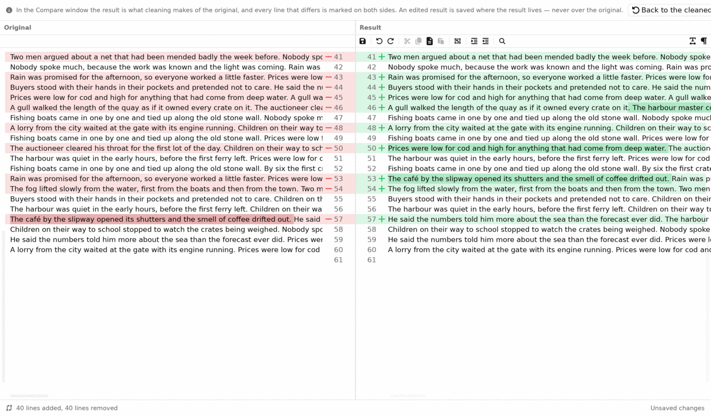
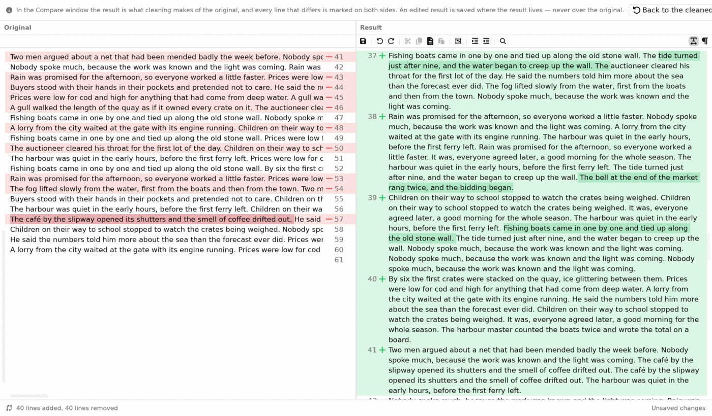
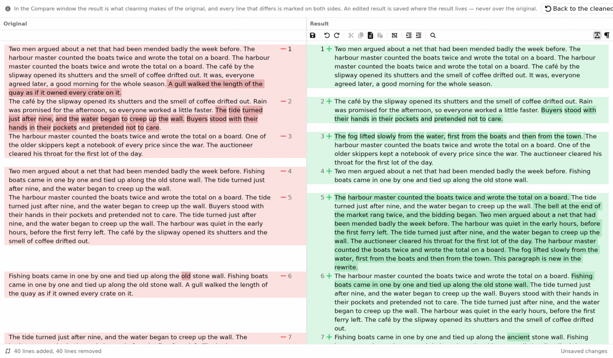
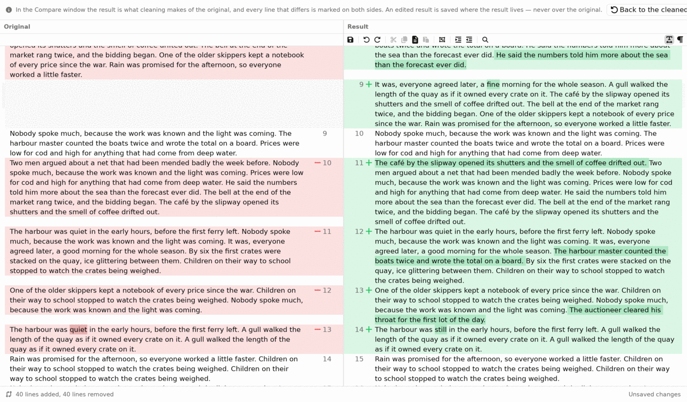

# E7-11 — Compare's two panes wrap and stay paragraph-level: spacer rows in gpui-kit's editor (2026-10-12)

**Для владельца.** В окне сравнения теперь можно включить перенос длинных
строк сразу для обеих панелей — кнопкой «Переносить длинные строки» над
результатом или строкой «Переносить длинные строки» в Настройках ›
Сравнение (она запоминается). Тогда обе стороны переносят строки по своему
краю, а более короткая сторона каждой пары строк дополняется пустыми рядами,
так что каждый абзац начинается вровень со своим партнёром на любой глубине,
как в side-by-side diff у Zed; абзац, который есть только с одной стороны,
стоит напротив серого пустого блока на другой. Прокрутка у выровненных
панелей общая — одно смещение на обе. Выделение слов не пропадает и в
переписанном документе из длинных абзацев. **По умолчанию перенос выключен**:
при включённом переносе каждое изменение ширины окна заново переносит оба
текста целиком — в контейнере это 316 мс на кадр для 200 абзацев и 9 секунд
для 8 МиБ, а сам выравнивающий расчёт занимает доли миллисекунды; лекарство
— в gpui-kit (дешевле переносить и не в кадре отрисовки), это предложено
отдельно. Что проверить глазами: откройте сравнение документа из длинных
абзацев, включите перенос — пары абзацев стоят вровень, пустые ряды и серые
блоки на месте, номера строк только у текста; прокрутите колесом и
ползунком обе стороны — они идут вместе; поменяйте ширину окна и
разделитель — через кадр снова вровень; наберите текст в результате — абзац
напротив подстраивается сразу; выключите перенос — всё как было. В gpui-kit
это два pull request'а из форка `glani`, открытые черновиками по слову
владельца — longbridge/gpui-kit#3465 и #3466, со скриншотами — и пример
`cargo run -p example-editor-spacers`.

Task: Watchword `wipemark-task-compare-spacer-rows-2026-10-12` (the
coordinator, for acceptance step A6). Built on `e7/compare-spacer-rows` from
`feat/e0-e6-shell` `ef0aa25`; the research it rests on is
`origin/research/compare-soft-wrap`
(`compare-soft-wrap-research-2026-10-12.md`). Decisions **D670–D678**
(`docs/plan/README.md` §4; D679–D689 left spare).

## What changed, in one table

| part | where | what |
|---|---|---|
| U1 | gpui-kit `editor-display-row-map` (`0555fc0a`), on `glani/gpui-component` | the editor's display-row map, read-only: `display_row_count`, `buffer_line_to_display_rows`, `display_row_to_buffer_line`, and `display_rows_version` |
| U2 | gpui-kit `editor-spacer-rows` (`97e11d2f`, `c65870fd`), on U1 | spacer rows in the display map; `Spacer`, `SpacerProvider`, `set_spacer_provider`, `refresh_spacers`, `is_spacer_row`; the Editor Diff story wraps and pads; the example `example-editor-spacers`; docs in English and Chinese |
| C | wipemark-app `e7/compare-spacer-rows` | one wrap state for both panes and the row `compare.wrap`; `Diff::padding`; the panes' spacer providers; one offset for padded panes; the line-pair split of word marks; the submodule on the fork |

## U1 — the display-row map (upstream pull request 1)

**Files.** `crates/base/src/input/base/state.rs` (the four methods, beside
`row_bounds`), `editor/display_map/display_map.rs` (`version`),
`editor/display_map/text_wrapper.rs` (a counter bumped when lines are
wrapped again), `editor/display_map/fold_map.rs` (a counter bumped when the
folded ranges change), `element.rs` (the test), `website/component/editor.md`
and its Chinese twin.

**The API.** `display_row_count()` — the rows the text takes once
soft-wrapped, less those hidden by folds; an editor not laid out has none.
`buffer_line_to_display_rows(line) -> Range<usize>` — one row per wrapped
row, laid out or not; a folded line is an empty range at the row its fold is
shown on, a line past the end an empty range at the end.
`display_row_to_buffer_line(row) -> (line, row_within)` — a row past the end
read as the last. `display_rows_version()` — a number that moves whenever a
line may have taken different rows: an edit, a rewrap, a fold opened or
closed, and not on a scroll or a frame that changes nothing.

**Why four, not the task's three** (D674). A reader of the map — the second
editor of a side-by-side pair, a minimap — has to know when to read it
again. An `InputEvent` variant would have said so, but `InputEvent` is not
`#[non_exhaustive]`, and a new variant breaks every exhaustive match
downstream; a version number breaks nothing. The counters move only on a
real change: the wrapper's `set_font` and friends return early when nothing
changes, and the fold map's `rebuild` runs every frame while folds exist, so
the fold counter moves in `set_folded`, `clear_folds`, `set_candidates` and
`adjust_folds_for_edit`, not in `rebuild`.

**Test.** `the_display_row_map_is_what_the_layout_draws`: a wrapped first
line, a folded line, a last line that wraps as the first does and is not laid
out; the map agrees with `row_bounds` for the laid-out rows and, once
scrolled to, for the last; every row names its line and its place in it;
past the end; without soft wrap one row a line; the version still across a
scroll and a frame, moved by a rewrap, a fold and an edit.

## U2 — spacer rows (upstream pull request 2)

**The design** (D674, the research's U2, Zed's `Block::Spacer`). A spacer
is a run of blank rows above or below a buffer line, and it is a layer of the
display map — `SpacerMap`, above `FoldMap`, the inverse of what folding does:
fold rows map to display rows pushed down by every spacer row above them.
Every display row stays one line height tall, which is what every geometry
in the editor assumes (`calculate_visible_range`, `scroll_to`, the caret);
that is the reason it is in the map and not beside it like the inline
completion's ghost lines, which thread through forty-nine places of
`element.rs`. Runs are sorted by the fold row they stand before, the rows
below a line before the rows above the next; both directions of the mapping
are a binary search over the runs; a spacer beside a line hidden by a fold,
or past the last line, is not placed.

**Who asks whom.** `SpacerProvider::spacers(lines, cx: &App) -> Vec<Spacer>`,
set with `set_spacer_provider` (on `EditorState`, as line decorations are).
Spacers move every row below them, so the editor asks for those of every
line at once and keeps the answer: when the provider is set, when the rows
move — `display_rows_version` differs from the one it last asked at — and on
`refresh_spacers`. It asks during prepaint, after the text is wrapped to the
editor's width and before anything is laid out by row, and outside any
update of the editor's state, so a provider may read this editor and another
one. Between an edit and the next ask the spacers already held are placed
again against the moved rows (`project_spacers` from
`rebuild_fold_projection`), so no spacer ever stands inside a line.

**What honours them.** The scroll height (`wrap_row_count` +
`spacer_row_count`); the visible range (the first laid-out line's block
starts above its spacers); `LastLayout::spacer_rows` and `spacers(ix)`, read
by every walk over the laid-out lines: `row_extents` (line decorations'
bands and markers, `row_bounds`), `layout_range_corners` (selections, search
matches, document colours, range decorations), fold icons, inline tokens,
indent guides, the caret's position and the IME bounds
(`line_and_position_for_offset`, `bounds_for_range`), hit testing (a pointer
on a spacer row is on the row of text beside it: its line's last row below
it, its first above), vertical movement (`text_display_row`: a target on a
spacer row steps past the spacers in the direction of travel), and the block
selection (a spacer row takes no selection). The four paint loops — the
active line, glyph backgrounds, the text with its ghost lines, the line
numbers — now read their tops from `row_extents()` rather than keeping
running sums of their own: the same tops without spacers (ghost lines shift
only rows after the caret's), the right ones with them, and one place to be
right in. Line numbers are blank on spacer rows because a line's number is
painted at its own top. `Spacer::with_background` fills a run's rows, gutter
included, under everything, as line decoration bands are.

**Files.** New: `editor/spacers.rs` (the public types),
`editor/display_map/spacer_map.rs` (the layer and its unit tests). Changed:
`display_map.rs`, `display_map/mod.rs`, `base/state.rs`, `base/element.rs`,
`base/layout.rs`, `base/movement.rs`, `base/kind.rs` (`InputExtras::spacer_provider`),
`editor/mod.rs`, `editor/indent.rs`, `input/mod.rs`; the component crate's
re-export; the story `editor_diff_story.rs`; `examples/editor_spacers`; the
docs (`website/component/editor.md`, `website/base/primitives/editor.md` and
both Chinese twins).

**Tests** (gpui-base unless said): `spacer_runs_match_the_dense_projection`,
`the_rows_below_a_line_come_before_the_rows_above_the_next`,
`a_line_with_spacers_on_both_sides_counts_both` (the layer against a
row-by-row projection); and in `element.rs`, each with soft wrap on and off
where it applies —
`spacer_rows_are_display_rows_that_push_every_row_below_them` (the map, the
spacer rows, `row_bounds`, the caret scrolled into view past every spacer,
the scroll height ten rows taller, the rows closing up when the provider
goes), `the_caret_and_a_click_never_stand_on_a_spacer_row` (down and up
across spacers, down from the last line, a click on a spacer below a line
and on one above the next, a block selection),
`bands_markers_and_fold_icons_stand_on_text_rows_only` (a band and a marker
per line on its first text row, the band's height the line's own, a fold
icon below a spacer, a spacer's background on its rows alone),
`ranges_are_laid_out_on_text_rows_only` (a range across three lines: the
corners every selection, search match and colour box is laid out from),
`spacers_beside_a_right_gutter_and_a_left_scroll_bar` (#3416, #3417 and the
clip, #3426: markers on the outer side at the text's rows, a click in the
text beside a right gutter), `spacers_are_asked_for_when_the_rows_move` (not
on a frame or a scroll; on an edit, a rewrap, a fold and a refresh; placed
again at once after an edit; a folded line's spacers gone; a missing line's
never placed). The story: `wrapped_sides_are_padded_level` (gpui-component-story).

**The story and the example.** The Editor Diff story gains a "Wrap long
lines" option; both sides carry a padding provider at all times (unwrapped,
equal rows ask for nothing) and the story asks both again when either side's
`display_rows_version` moves; one of its changed lines is now long enough to
wrap taller. `example-editor-spacers` (the owner, 2026-10-12: "a test example
in the editor with this behaviour") is two versions of a prose text side by
side, padded from a hand-written pairing, a paragraph only one version has
standing beside a muted block, one scroll offset for both and a Wrap switch;
`cargo run -p example-editor-spacers`.

**Upstream's gates** on both branches, in the container (toolchain 1.95.0,
aarch64): `cargo fmt --check` clean; `cargo clippy` on `gpui-base`,
`gpui-component`, the story and the example with `-D warnings` clean but for
two `nonminimal_bool` errors in `calendar.rs` that are upstream's on `next`
(silenced to see past them; CI's clippy, on macOS's stable, passes);
`cargo test -p gpui-base --lib` 1352 passed and 3 failed — the three
`motion::` tests that fail on a clean `next` in this container too (timing);
`gpui-component` 650 and the story 20 passed; `typos` and
`script/check-ai docs` clean. **CI on the fork's draft pull requests**
(`glani/gpui-component#1`, `#2`): every job green on both — Checks, Lint,
No default features, Test on macOS, Linux and Windows, the shell jobs
(runs `38290847872`, `38292430568`).

## C — Wipemark

**Files.** `apps/wipemark-app/src/compare.rs` (the `Level` and `Padded`
providers, `CompareView::wrap`, `refresh_level`, `keep_level`, `across`, the
scroll functions without their wrapped branches, the frame-time trace, the
module docs, the tests), `diff.rs` (`Pad`, `Padding`, `Rows`,
`Diff::padding`, the line-pair split in `spans`, the tests), `result.rs`
(`ResultEvent::Wrapped`, `set_soft_wrap`), `config.rs` (`compare.wrap`),
`settings.rs` (the row and its switch), the three catalogues
(`settings-compare-wrap-title`/`-description`, and the scroll row's
description rewritten), `Cargo.toml` (`gpui_platform`'s `test-support` as a
dev-dependency feature, D676), `Cargo.lock` (two dependency edges, no new
crate), `.gitmodules` and the submodule (D675), `fixtures/compare/long-paragraphs/`,
`scripts/verify/e7-11/` (`make-fixture.py`, `resize.sh`, `shots.sh`), the
docs (`docs/architecture/compare.md`, `docs/architecture/rules.md`,
`docs/plan/README.md` §4).

**Behaviour.**
- One wrap state (D670): `compare.wrap`, read when a window opens; the
  result toolbar's Wrap long lines wraps both panes of the open window. Off
  by default for now (D677).
- Wrapped, the panes are padded (D670): `Diff::padding` pairs shared lines
  one for one and, inside a hunk, line *i* with line *i*; the shorter of
  each pair gets the difference below it, blank; the lines past the shorter
  block's count get blank rows at the end of the shorter block, tinted with
  the theme's muted colour; the editor's empty line after a final newline is
  paired too, and a comparison that no longer fits the texts pads them as
  far as it fits (D678).
- One offset for padded panes (D672); D380's row map for unwrapped ones.
- The other pane asked again when its partner's rows move (D673): on the
  result's `Changed`, before the frame (an edit is level in its own frame),
  and at the end of every frame for a pane whose spacers are stale (a rewrap
  is level a frame later for the pane laid out first).
- Word marks past the ceiling (D671): line *i* against line *i*.
- The cursor follow (D383) still follows buffer rows: the original's caret
  goes to the partner line, then the original is set to the result's
  offset — padded, the same one (`the_cursor_follow_does_not_drag_the_result`
  unwrapped, `the_cursor_follow_keeps_padded_panes_at_one_offset` padded).

**Tests.** `compare.rs`: `paired_lines_start_level_when_both_wrap` and
`…_marked_by_whole_lines` (with whole-line marks no empty edit of the
original follows a comparison, and the padding moves with the comparison's
number alone), `the_toolbar_wraps_both_panes_and_pads_them`,
`an_edit_is_padded_level_in_its_own_frame` and
`a_rewrap_pads_the_other_pane_by_the_next_frame` — both read a test-only
count of the panes the end of a frame had to ask again (`late`), because
GPUI's test mode paints a dirty window until nothing is dirty and so hides a
frame of lag from what the panes settle on: none after an edit, at least one
after a rewrap — `the_cursor_follow_keeps_padded_panes_at_one_offset`,
`a_new_comparison_pads_both_panes_again`,
`padded_panes_scroll_at_one_offset`, `a_line_far_below_stands_level_at_once`,
`two_padded_panes_moved_in_one_frame_end_where_the_result_put_them`,
`both_panes_stand_level_in_the_frame_a_scroll_bar_is_dragged` (now wrapped
and unwrapped), and `compare_screenshots` (ignored, D676). `diff.rs`:
`a_paired_line_is_padded_by_the_rows_its_partner_wraps_taller`,
`lines_one_side_has_stand_beside_filler_at_the_end_of_the_others_block`,
`a_comparison_that_no_longer_fits_pads_as_far_as_it_fits`,
`a_rewritten_document_keeps_its_word_marks`,
`a_passage_too_big_to_align_is_compared_line_by_line` (replaces
`…_keeps_its_line_marks`, D671). `config.rs`: the defaults and the round
trip carry `wrap`, an unusable `compare.wrap` reads as the default and stays
in its row. Gone with what they guarded: `with_the_result_wrapped_it_leads_a_frame_late_and_no_later`
(D449's exception), `a_wrapped_result_still_leads_and_follows`,
`two_panes_moved_in_one_frame_end_where_a_wrapped_result_put_them` (D433),
`a_wrapped_result_far_away_is_placed_by_estimate` (D384) — each replaced by
the padded test above. The D380-family tests open unwrapped explicitly
(`unwrapped()`), since that is the window they describe.

**The decision on the synchronised scroll** (D672). Superseded:
**D384** (a wrapped pane read off its last layout, placed by estimate where
not laid out — `wrapped_offset_for`, deleted), **D386** in part (a wrapping
pane read only at the end of a frame; the end-of-frame look stays),
**D433** (a look waits while a wrapping result moved unseen —
`moved_unseen`, deleted), **D449**'s exception (a wrapped result followed a
frame late). Kept: D380, D381 (unwrapped panes), D382, D383, D385, D387,
D390, D391, D392, D432, D449 (now measured wrapped too). The basis is the
owner's: padding, not proportional alignment of unpadded wrapped panes —
padded panes have the same rows, so one offset is exact, for laid-out rows
and not, in the same frame; and with one wrap state there is no wrapped,
unpadded pane left for the estimate to serve.

## The upstream texts

The two pull requests are open **as drafts**, on the owner's word
(2026-10-12): longbridge/gpui-kit#3465 (`glani:editor-display-row-map`) and
#3466 (`glani:editor-spacer-rows`, on top of #3465), into `next`, "Allow
edits from maintainers" on, `des <denis.yesakov@gmail.com>` the only author
(CLAUDE.md), the texts below with the hard wraps joined. #3466's screenshots
are on `GigLaboCom/gpui-component` `pr-assets` (`b6420d7`,
`screenshots/spacer-rows-*.png`), drawn in the container by
`scripts/verify/e7-11/kit-shots.sh` — the story wrapped with its spacer
providers taken away as the "before"; its "Passed `cargo run`" box stays
unticked until the story has been run on a display (the host check). The
issue below is not filed.

### The issue for U2 (the research's advice: propose before writing)

> **Title:** Editor: spacer rows in the display map, for side-by-side diffs
> that wrap
>
> **Problem.** Two editors shown side by side — a diff, a translation, a
> review — stay level only while no line wraps. With soft wrap on, the same
> paragraph takes nine rows on one side and twelve on the other, and every
> pair below drifts further apart; no scroll synchronisation can fix that,
> because the two sides do not have the same rows.
>
> **Proposal.** Blank *spacer* rows, in the display map, above or below a
> buffer line — what Zed's side-by-side diff does with
> `Block::Spacer { id, height, is_below }`
> (`crates/editor/src/display_map/block_map.rs`, `spacer_blocks` /
> `determine_spacer`, and `split.rs` for the two sides sharing one soft-wrap
> state and one scroll anchor). A layer above `FoldMap`, its inverse: fold
> rows map to display rows pushed down by the spacer rows above them. Every
> row stays one line height, so the editor's geometry is unchanged; line
> numbers, the caret, selections, decorations and search pass a spacer row
> by; the scroll height and `row_bounds` count it.
>
> **API sketch.**
> ```rust
> pub struct Spacer { /* line, rows, above, background */ }
> impl Spacer {
>     pub fn below(line: usize, rows: usize) -> Self;
>     pub fn above(line: usize, rows: usize) -> Self;
>     pub fn with_background(self, color: Hsla) -> Self;
>     // line(), rows(), is_above(), background()
> }
> pub trait SpacerProvider {
>     fn spacers(&self, lines: Range<usize>, cx: &App) -> Vec<Spacer>;
> }
> impl EditorState {
>     pub fn set_spacer_provider(&mut self, provider: Option<Rc<dyn SpacerProvider>>, cx: &mut Context<Self>);
>     pub fn refresh_spacers(&mut self, cx: &mut Context<Self>);
> }
> impl<M> InputBaseState<M> { pub fn is_spacer_row(&self, row: usize) -> bool; }
> ```
> The provider is asked for every line at once when the rows move (an edit,
> a rewrap, a fold) and on `refresh_spacers`, during layout once the text is
> wrapped to the editor's width, so it can pad one editor against another's
> rows — read through the display-row map of #(U1).
>
> **Alternative considered.** Extra rows outside the map, as inline
> completion's ghost lines are: they thread through every loop that walks
> the laid-out lines, which is where the bugs live.
>
> **Questions.** Is a provider asked for every line the right shape, or
> would you rather have a collection, as line decorations have? Should a
> spacer row's background be the application's, per spacer, or a theme
> token?

### Pull request 1

**Title:** `editor: Expose the display-row map`

> ## Description
>
> The editor's display map knows, for every buffer line, how many rows it
> takes after soft wrapping and folding, but nothing outside the input
> module can ask it. A view that keeps two wrapped editors level, a
> minimap, or anything placing rows that are not laid out has to estimate
> from the last layout instead, since `row_bounds` answers only for rows in
> it.
>
> This adds four read-only methods on `InputBaseState` that forward to the
> display map, and a version number the wrap and fold layers keep: it moves
> when the text is wrapped again or the folded ranges change, never on a
> frame or a scroll, so a reader knows when to read again without a new
> event (adding an `InputEvent` variant would break exhaustive matches).
>
> ## Public API
>
> ### gpui-base (`gpui_kit::base::input`, re-exported by `gpui_kit::component::input`)
>
> - `InputBaseState::display_row_count(&self) -> usize` — the rows the text
>   takes once soft-wrapped, less those hidden by folds.
> - `InputBaseState::buffer_line_to_display_rows(&self, line: usize) -> Range<usize>`
>   — the display rows a buffer line takes, laid out or not; empty for a
>   folded line, at the row its fold is shown on.
> - `InputBaseState::display_row_to_buffer_line(&self, row: usize) -> (usize, usize)`
>   — the buffer line a display row shows, and which of its wrapped rows.
> - `InputBaseState::display_rows_version(&self) -> usize` — moves whenever a
>   line may have taken different rows.
>
> ## How to Test
>
> - `cargo test -p gpui-base --lib the_display_row_map_is_what_the_layout_draws`:
>   a wrapped line, a folded one and a wrapped line that is not laid out; the
>   map agrees with `row_bounds` where rows are laid out, and the version
>   moves on a rewrap, a fold and an edit, and not on a scroll.
>
> ## Checklist
>
> - [x] I have read the [CONTRIBUTING](../CONTRIBUTING.md) document and followed the guidelines.
> - [x] Reviewed the changes in this PR and confirmed AI generated code (If any) is accurate.
> - [x] Passed `cargo run` for story tests related to the changes.
> - [ ] Tested macOS, Windows and Linux platforms performance (if the change is platform-specific)

### Pull request 2

**Title:** `editor: Add spacer rows to the display map`

> ## Description
>
> Two editors shown side by side stay level only while no line wraps: with
> soft wrap on, the same paragraph takes more rows on one side than on the
> other, and every pair below it drifts. This adds **spacer rows** to the
> display map — blank rows above or below a buffer line, with no line
> number, no caret and no decoration, as Zed's side-by-side diff has them
> (`Block::Spacer`) — and a provider to say where they go. On top of #(PR 1).
>
> They are a layer of the display map above folding, its inverse, so every
> row keeps one line height and the scroll height, `scroll_to` and
> `row_bounds` count them. Selections, search matches, document colours,
> range decorations, line decoration bands and markers, fold icons, indent
> guides and inline tokens pass them by; the caret steps over them; a click
> on one lands on the row of text beside it; a block selection skips them.
> The text, the glyph backgrounds, the line numbers and the active line are
> now painted at `row_extents()`, the one place spacers and ghost lines are
> accounted for, instead of each keeping a running sum — the same tops when
> there are no spacers.
>
> The Editor Diff story gains a "Wrap long lines" option that pads both
> sides level, and `examples/editor_spacers` shows two versions of a prose
> text padded level, a paragraph only one has standing beside a filled block.
>
> This changes Base: the display map and the editor's layout live there.
>
> ## Screenshot
>
> (the Editor Diff story, wrapped, before and after — from the owner's machine)
>
> ## Public API
>
> ### gpui-base (`gpui_kit::base::input`, re-exported by `gpui_kit::component::input`)
>
> - `Spacer::below(line: usize, rows: usize) -> Spacer` /
>   `Spacer::above(line: usize, rows: usize) -> Spacer` — blank rows below or
>   above a zero-based buffer line.
> - `Spacer::with_background(self, color: Hsla) -> Spacer` — fill the rows,
>   gutter included; `Spacer::line`, `rows`, `is_above`, `background` read
>   them back.
> - `trait SpacerProvider { fn spacers(&self, lines: Range<usize>, cx: &App) -> Vec<Spacer>; }`
>   — asked for every line when the rows move and on `refresh_spacers`.
> - `InputBaseState<EditorMode>::set_spacer_provider(&mut self, provider: Option<Rc<dyn SpacerProvider>>, cx: &mut Context<Self>)`.
> - `InputBaseState<EditorMode>::refresh_spacers(&mut self, cx: &mut Context<Self>)`
>   — ask again at the next layout, when something the answer depends on
>   changed elsewhere (another editor's rows).
> - `InputBaseState::is_spacer_row(&self, row: usize) -> bool`.
>
> ## How to Test
>
> - `cargo test -p gpui-base --lib spacer` and the four tests named for the
>   caret, bands, ranges and gutters (`the_caret_and_a_click_never_stand_on_a_spacer_row`,
>   `bands_markers_and_fold_icons_stand_on_text_rows_only`,
>   `ranges_are_laid_out_on_text_rows_only`,
>   `spacers_beside_a_right_gutter_and_a_left_scroll_bar`), each with soft
>   wrap on and off; `cargo test -p gpui-component-story --lib wrapped_sides_are_padded_level`.
> - `cargo run`, Editor Diff, Options › Wrap long lines: narrow the window;
>   every pair of lines starts level, the line numbers only beside text.
> - `cargo run -p example-editor-spacers`.
>
> ## Checklist
>
> - [x] I have read the [CONTRIBUTING](../CONTRIBUTING.md) document and followed the guidelines.
> - [x] Reviewed the changes in this PR and confirmed AI generated code (If any) is accurate.
> - [x] Passed `cargo run` for story tests related to the changes.
> - [ ] Tested macOS, Windows and Linux platforms performance (if the change is platform-specific)

## Measurements (D677)

`scripts/verify/e7-11/resize.sh`, release build, the container (aarch64,
12 cores, lavapipe), the Compare window resized from 1400 to 900 pixels and
back in 20-pixel steps (prose) or 100-pixel steps (8 MiB), each step waiting
for the frame it causes; the time from the layout before the two panes to
the paint after them (a trace line, `wipemark::compare`).

| document | wrap | frames | median | p95 | largest | over 16 ms | the padding's own |
|---|---|---|---|---|---|---|---|
| 200 paragraphs, 90 KB | off | 85 | 0.8 ms | 1.4 ms | 3.2 ms | 0 | — |
| 200 paragraphs | on, padded | 56 | **316 ms** | 526 ms | 708 ms | 51 | 0.02–0.1 ms |
| 8 MiB, 18 889 paragraphs, none the same | off | 10 | 0.9 ms | 3.1 ms | 3.1 ms | 0 | — |
| 8 MiB | on, padded | 4 | **9.1 s** | 10.5 s | 10.5 s | 4 | 3–46 ms |

The first frame of a wrapped 8 MiB window takes 15.4 s. The time is the
library's rewrap: each pane spends about 180 ms of a 200-paragraph frame
before its spacers are asked for (the trace's two padding lines bracket the
second pane's rewrap). `TextWrapper::update_all` wraps every line again on
every width change, and `measured_wrap_boundaries` finds each visual row's
end by shaping prefixes, exponentially then by bisection — about fourteen
shapings of a row's length per row. An 8 MiB text of *repeated* paragraphs
measured 0.8 s, GPUI's shaped-line cache answering for the repeats; the
figure above numbers every paragraph so none repeats.

**Remedy, proposed** (upstream; not built here): wrap plain text through
GPUI's `LineWrapper` — one pass over a line with cached glyph widths, what
Zed wraps with — where `measured_wrap_boundaries` exists for inline elements
and exact shaping; and take the rewrap off the paint path — keep the last
wrap until the new one is ready, on a background task (Zed's `WrapMap`
does), or hold the wrap width while a live resize is in progress and wrap
once it settles. **Until then `compare.wrap` is off by default**; a person
turns it on in Settings › Compare or with the toolbar button, and resizing a
wrapped window of a long document is slow, as it already was for a wrapped
result alone.

## Screenshots

`compare::tests::compare_screenshots` (D676) through `scripts/verify/e7-11/shots.sh`,
the window on `fixtures/compare/long-paragraphs/` with its rewrite put in
the result, the original scrolled 40 lines down and the result placed by the
window's own scrolling together; 1400 pixels wide, 128 colours. The full set
(ten pictures, 2800 pixels wide, top and scrolled for each state) is the
Watchword file `wipemark-compare-spacer-rows-screenshots-2026-10-12`.

| | |
|---|---|
| **Wrap off** — long lines run past the pane; the row map keeps the two in step.  | **Wrap on, unpadded, as the window was before** (`feat` `ef0aa25`): the result wrapped, the original not, the result placed by D384's estimate — paragraph 41 on the left beside 37 on the right, and twenty lines on the left beside five paragraphs.  |
| **Wrap on, padded** — the top: every pair starts level, the shorter side padded below.  | **Wrap on, padded**, scrolled: paragraph 9 on the left beside 10 on the right, the result's new paragraph 9 beside a muted block.  |

The first padded picture shows the one limit of pairing by position (said in
`compare.md`): the fixture puts a new paragraph in among rewritten ones, so
inside that hunk the original's paragraph 5 stands beside the result's new
paragraph and each one after it beside the next one's partner, up to the end
of the hunk, where the filler stands and the pairs are right again.

## Gates

**In the container only the gates of what was touched** (the owner,
2026-10-12: the full list is an hour here). The full list — all of
CLAUDE.md "Gates" with `--locked`, `local-llama`, the pipeline's examples,
`gpui-pre-linux` — is CI's (`gate.yml` on the push of this branch: run
`38303975943` on `77b7ee6`, the code of `9c3a018`, whose own run the second
push cancelled) and the host check's (`FULL=1 …-gates.sh`).

`docs/plan/reports/E7-11-compare-spacer-rows-2026-10-12-gates.sh` (scoped by
default), on the final sources:

| gate | exit | counts |
|---|---|---|
| `rustfmt --check` (nightly, every file) | 0 | |
| `cargo clippy -p wipemark-app -p wipemark-i18n --all-targets --locked -- -D warnings` | 0 | |
| `cargo test -p wipemark-app --locked` | 0 | 843 passed, 0 failed, 3 ignored |
| `cargo test -p wipemark-i18n --locked` | 0 | 41 passed |
| `scripts/check-dep-direction.sh` | 0 | |
| `scripts/check-gpui-pin.sh` | 0 | |

Also, from a full run stopped part way on the same sources:
`cargo clippy --workspace --all-targets --locked -- -D warnings` exit 0.
Not run in the container: the workspace's other crates' tests (untouched),
`check-zune-pin`, the `--no-default-features` and `local-llama` checks and
tests, the pipeline's examples, `gpui-pre-linux`'s tests — CI's and the
host's. The native llama gates are not due (nothing under
`crates/wipemark-llama*` or `wipemark-engine/src/local.rs`).

## Red checks

`docs/plan/reports/E7-11-compare-spacer-rows-2026-10-12-red.py`, every
protection taken out once and its test seen red, then put back:

28 checks, 28 red. The upstream group ran in the gpui-kit clone
(`GPUI_KIT=/workspace/gpui-kit-spacer`, `cargo test -p gpui-base --lib` or
the story), the C group at the repository root.

| check | protection taken out | red tests |
|---|---|---|
| U1-rows | `buffer_line_to_display_rows` answers one row a line | `the_display_row_map_is_what_the_layout_draws` |
| U1-row-within | `display_row_to_buffer_line` answers row 0 of the line | the same |
| U1-version-wrap | the wrapper's version not bumped by a rewrap | the same, `spacers_are_asked_for_when_the_rows_move` |
| U1-version-fold | the fold map's version not bumped by an opened fold | `the_display_row_map_is_what_the_layout_draws` |
| U2-map | a fold row not pushed down by the spacer rows above it | `spacer_runs_match_the_dense_projection`, `spacer_rows_are_display_rows_that_push_every_row_below_them` |
| U2-count | `display_row_count` without the spacer rows | `spacer_rows_are_display_rows_…` |
| U2-visible-top | the first laid-out block starting below its spacers | the same |
| U2-row-extents | `row_extents` not stepping over the spacers above | the same, `bands_markers_and_fold_icons_stand_on_text_rows_only` |
| U2-range-corners | ranges not stepping over the spacers above | `ranges_are_laid_out_on_text_rows_only` |
| U2-fold-icons | fold icons not stepping over the spacers above | `bands_markers_and_fold_icons_…` |
| U2-click | a pointer on a spacer row not clamped to the row beside it | `the_caret_and_a_click_never_stand_on_a_spacer_row` |
| U2-movement | vertical movement not stepping past spacer rows | the same |
| U2-columnar | a block selection taking spacer rows | the same |
| U2-scroll-height | the scroll height without the spacer rows | `spacer_rows_are_display_rows_…` |
| U2-ask-again | the provider asked once, never again | `spacers_are_asked_for_when_the_rows_move` |
| U2-place-again | the spacers not placed again when the rows move before an ask | the same |
| U2-cleared | a provider taken away leaving its spacers | `spacer_rows_are_display_rows_…` |
| U2-story | the story padding nothing | `wrapped_sides_are_padded_level` |
| C-padding-pairs | a paired line not padded by its partner's taller wrap | `a_paired_line_is_padded_by_…`, `paired_lines_start_level_when_both_wrap`, `…_marked_by_whole_lines` |
| C-padding-filler | no filler for lines one side lacks | `lines_one_side_has_stand_beside_filler_…`, both `paired_lines_…` |
| C-diff-number | a landed comparison not moving the padding's key | `a_new_comparison_pads_both_panes_again` |
| C-pair-split | no line-against-line comparison past the ceiling | `a_rewritten_document_keeps_its_word_marks`, `a_passage_too_big_to_align_is_compared_line_by_line` |
| C-one-wrap-state | the toolbar's Wrap wrapping the result alone | `the_toolbar_wraps_both_panes_and_pads_them`, `a_rewrap_pads_the_other_pane_by_the_next_frame` |
| C-one-offset | padded panes scrolled by the row map | `padded_panes_scroll_at_one_offset`, `two_padded_panes_moved_in_one_frame_…`, `both_panes_stand_level_in_the_frame_a_scroll_bar_is_dragged` |
| C-refresh-on-edit | the original not asked again on the result's `Changed` | `an_edit_is_padded_level_in_its_own_frame` |
| C-keep-level | no end-of-frame ask of a stale pane | `a_rewrap_pads_the_other_pane_by_the_next_frame` |
| C-wrap-row | the row not read | `the_compare_rows_default_to_words_and_survive_a_restart` |
| C-wrap-widget | the row without a widget | `every_persisted_preference_has_a_row` |

Two were green at first and their tests were made to see them.
**C-refresh-on-edit**: GPUI's test mode paints a dirty window again at once,
so the end-of-frame catch hid the frame of lag; the tests now count the
panes that catch asked (`late`). **C-diff-number**: after a comparison
lands, the original's empty edit (word marks) and the save under way moved
a version anyway; the protection is now checked directly
(`a_new_comparison_pads_both_panes_again`). And **C-wrap-widget** first
did not build — the array's length had to go with the row; the entry takes
both out.

## Deviations

- **The fork's name.** The task names `glani/gpui-kit`; the owner's fork of
  `longbridge/gpui-kit` is `glani/gpui-component` (the old name). The
  branches are there; the account's repository was not renamed (D675).
- **Draft pull requests in the fork.** The task said no pull request
  anywhere; the owner asked during the round for "branches, no PRs — only
  drafts for tests". Two drafts inside the fork (`glani/gpui-component#1`,
  base `next`, a mirror of upstream's `24ded30c`; `#2`, base the U1 branch)
  run its CI; nothing was opened upstream.
- **U1 has four methods**, not three (`display_rows_version`, see U1).
- **`compare.wrap` is off by default** (D677), where the task asked for on —
  by the task's own condition on a resize frame over 16 ms.
- **Pictures with no display** (D676): the task said Xvfb; on an Xvfb in the
  container GPUI's windows stayed black (lavapipe presents nothing to it),
  so the window is drawn by GPUI's headless renderer, which needs
  `gpui_platform`'s `test-support` in the app's dev-dependencies. The
  story and the example are not pictured here: their editors and switches
  are private to their crates, and a picture of them is the host check's.
- **The "before" picture** was made on `origin/feat/e0-e6-shell` in a
  temporary worktree with the same test, ported (`shots.sh BASE=…`).
- **A stray file, removed.** The first push of the example commit carried a
  `typos` wheel downloaded into the clone; the commit was amended and the
  branch force-pushed (`50194599` → `e7ab2204`; later `c65870fd`, when a
  test's needless borrow was folded into the spacer commit) before anything
  was built on it upstream.
- **Gates scoped to what was touched** in the container (the owner's word,
  2026-10-12), the full list left to CI and the host; see "Gates".
- **A trace line in the product**: `the panes laid out and painted` and `the
  padding worked out`, at `trace`, no text in them — the measurement's
  instrument, kept so the figures can be made again.

## What is left

- **The remedy for a wrapped resize** (D677), upstream: `LineWrapper` for
  plain text, the rewrap off the paint path; then `compare.wrap` on by
  default.
- **Pairing by likeness inside a hunk**: a hunk whose two blocks differ in
  length pairs by position; aligning its paragraphs by word overlap (a small
  dynamic programme over the block, bounded like `CELLS`) would keep a
  paragraph put in among rewritten ones from shifting the pairs below it.
  Both the padding and the word marks would take it.
- **Upstream review**: #3465 and #3466 out of draft when the owner says so
  (the issue above is not filed); after the merge, the submodule back on
  `longbridge/gpui-kit` `next` and `.gitmodules` restored, and only then the
  merge into `feat` (D675).
- **The host check**: Watchword `wipemark-task-compare-spacer-rows-host-check-2026-10-12`.
- Unchanged and not touched: a wrapped pane's horizontal scroll bar is not
  drawn (the library's), and the original's toolbar strip stays blank.

## For the coordinator: CLAUDE.md

Not edited (the task's rule). Sentences to change:

1. In the Compare rule ("The Compare window is three things kept apart…"),
   replace "And the two panes **scroll together** (`compare.sync_scroll`, on
   by default, read when a window opens): … the result is weighed first
   however its position is read (D433)." with the paragraph now in
   `docs/architecture/rules.md` from "**Long lines wrap on both sides, padded
   level**" to "(D432)."
2. In "First command after any clone or submodule update", after "Nothing of
   ours is carried on it.": "**Except on `e7/compare-spacer-rows`**, until
   upstream merges U1 and U2: its submodule points at `glani/gpui-component`
   `editor-spacer-rows` (`.gitmodules` changed on that branch alone, D675)."
3. In "Epic order", after the Compare follow-ups: "**E7-11, Compare's panes
   wrapped and padded level** (D670–D678) is built on `e7/compare-spacer-rows`,
   not merged: it waits for gpui-kit to merge U1 (`editor-display-row-map`)
   and U2 (`editor-spacer-rows`) from the `glani` fork; `compare.wrap` is
   off by default until a wrapped resize fits a frame (D677)." And the next
   free decision block: **D679**.
4. In the Watchword table: `wipemark-task-compare-spacer-rows-2026-10-12`
   (FILE, the task), `wipemark-compare-spacer-rows-report-2026-10-12` (FILE,
   this report), `wipemark-compare-spacer-rows-screenshots-2026-10-12` (FILE,
   the pictures), `wipemark-task-compare-spacer-rows-host-check-2026-10-12`
   (FILE, the host check).
